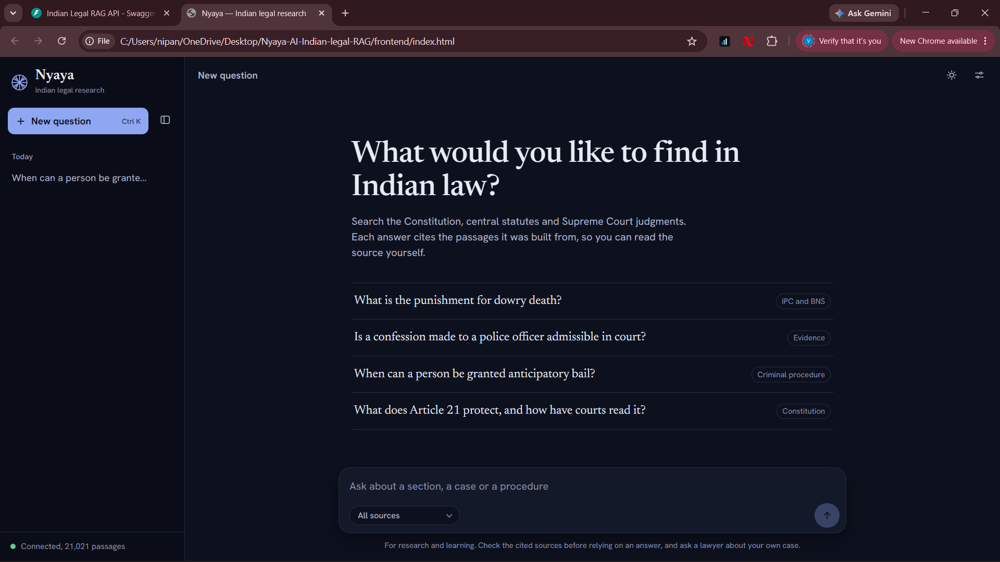
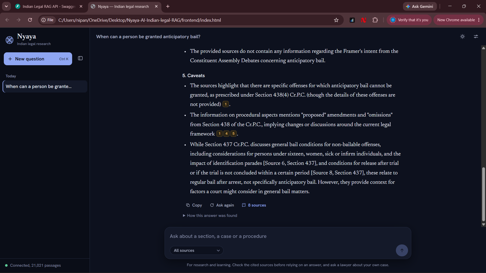
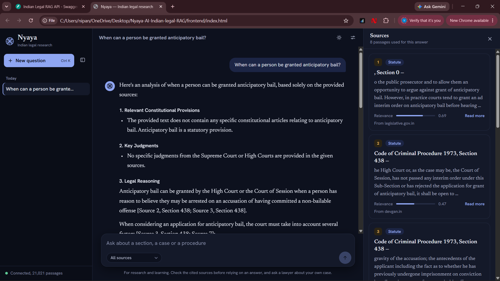
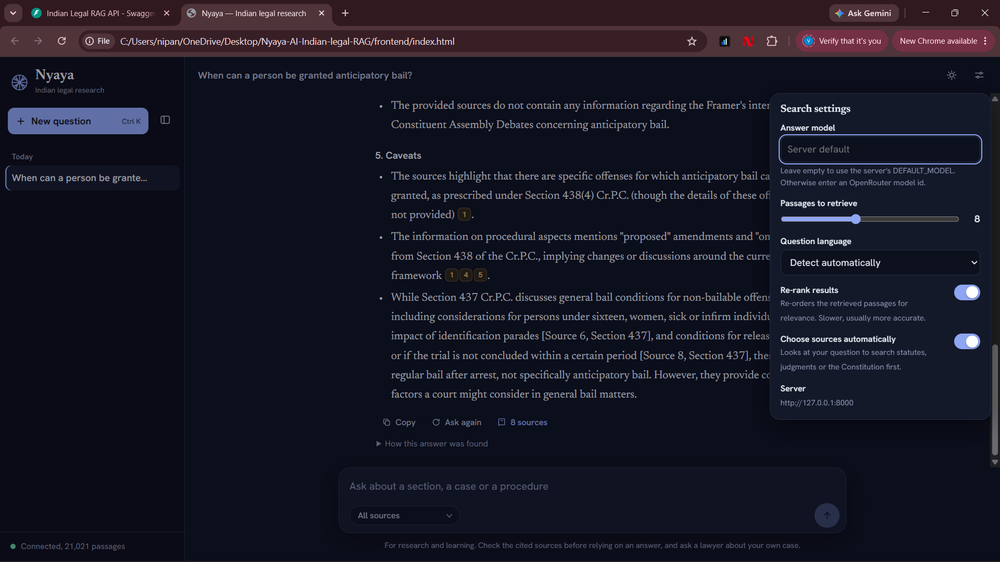
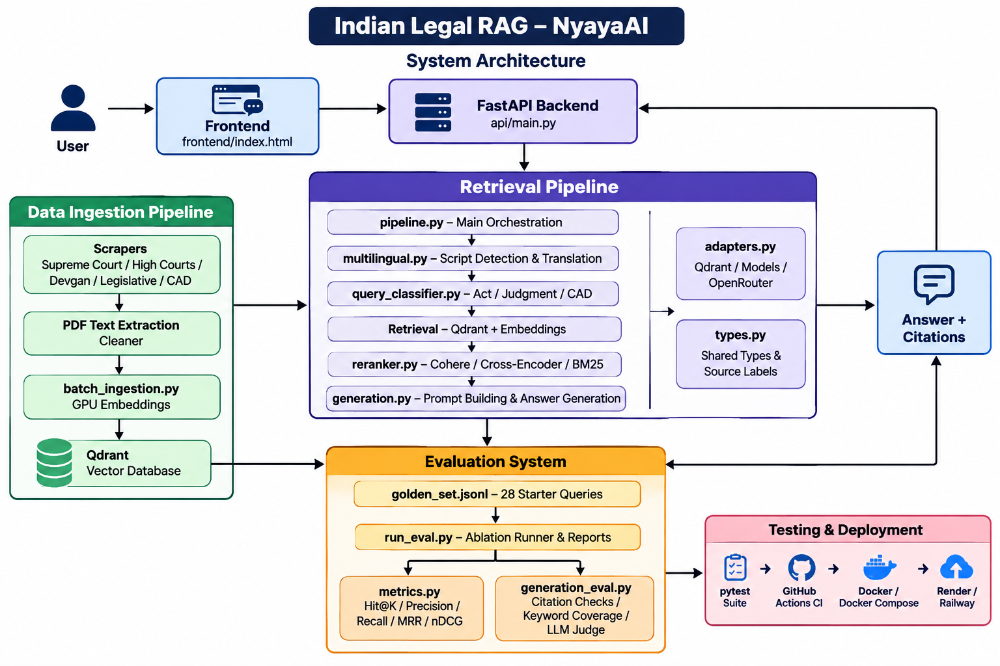
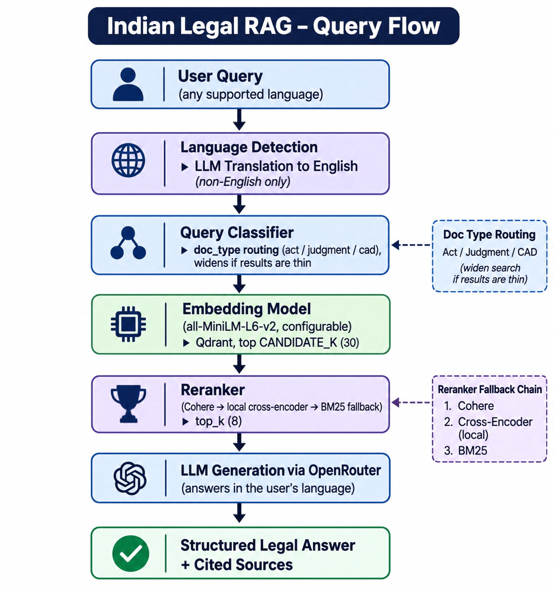

# NyayaAI — Indian Legal Intelligence RAG System

A production-grade Retrieval-Augmented Generation (RAG) system for Indian law. Ask questions about the Indian Constitution, Supreme Court judgments, Acts of Parliament, and Constituent Assembly Debates — and get structured, cited answers powered by AI.


---

## What It Does

NyayaAI answers legal queries by:
1. Detecting the question's language and translating non-English queries (Hindi, Marathi, Tamil, ...) for retrieval
2. Classifying the question and routing it to acts, judgments or Constituent Assembly Debates
3. Embedding it with a local GPU-accelerated model and retrieving a wide candidate pool from Qdrant
4. Reranking the candidates (Cohere, a local cross-encoder, or BM25 as an offline fallback)
5. Feeding the best passages to an LLM (Claude/DeepSeek/Llama) and answering in the user's language
6. Returning a structured legal answer with citations, dense and rerank scores

---

## Demo

| Home | Answer with citations |
|---|---|
|  |  |

| Source passages panel | Search settings |
|---|---|
|  |  |

Every answer cites the exact passages it was built from, so you can read the source yourself. Search settings let you change the answer model, number of passages, question language, re-ranking and automatic source selection.

---

## Data Sources

| Source | Content | Volume |
|--------|---------|--------|
| AWS Open Data | Supreme Court judgments 1950–2025 | 150+ judgments |
| Devgan.in | BNS, CrPC sections (BNSS/BSA/IPC pages are often unavailable there) | section by section |
| courtbook.in | BNSS, BSA sections (automatic fallback when Devgan fails) | section by section |
| legislative.gov.in | Constitution of India, RTI, IT Act, POCSO | 8 Acts |
| constitutionofindia.net | Constituent Assembly Debates (12 volumes) | 60+ sessions |

---

## Project Structure

```
Indian-legal-RAG/
├── api/main.py                    # FastAPI backend (thin; logic lives in retrieval/)
├── retrieval/
│   ├── query_classifier.py        # rule-based routing: act / judgment / cad
│   ├── reranker.py                # Cohere, cross-encoder, BM25 + fallback chain
│   ├── pipeline.py                # translate → classify → retrieve → rerank
│   ├── multilingual.py            # script detection + LLM query translation
│   ├── generation.py              # prompt building + answer generation
│   ├── adapters.py                # Qdrant / sentence-transformers / OpenRouter wiring
│   └── types.py                   # shared types, source labels
├── evaluation/
│   ├── metrics.py                 # hit@k, P@k, pooled recall@k, MRR, nDCG@k
│   ├── generation_eval.py         # citation checks, keyword coverage, LLM judge
│   ├── run_eval.py                # ablation runner + JSON/Markdown reports
│   └── golden_set.jsonl           # 28 starter queries (statute/constitution/case law/CAD/multilingual)
├── embeddings/batch_ingestion.py  # GPU embedding + Qdrant upload (idempotent)
├── ingestion/
│   ├── scraper/                   # SC (+ sc_metadata, backfill), High Courts, Devgan, courtbook, Legislative, CAD
│   ├── cleaner/PDF_text_extracter.py, split_act_pdf.py   # PDF -> per-section records
│   └── run_all_scraper.py         # mvp | full | scale
├── frontend/index.html            # chat UI (API base configurable)
├── tests/                         # pytest suite (no GPU / Qdrant / network needed)
├── Dockerfile, docker-compose.yml, render.yaml, railway.json
├── .github/workflows/ci.yml
├── .env.example
└── requirements.txt, requirements-api.txt
```

* * *

## Prerequisites

- **Python 3.12.x** (not 3.13 or 3.14 — PyTorch requires 3.12)
  - Download: https://python.org/downloads/release/python-31210/
- **Docker Desktop** (for Qdrant vector database)
  - Download: https://docker.com/products/docker-desktop
- **NVIDIA GPU** with CUDA support (optional but recommended)
  - CPU works but is much slower for embedding
- **OpenRouter API key** (for LLM generation)
  - Get one free at: https://openrouter.ai/keys

---

## Installation

### 1. Clone the repository

```bash
git clone https://github.com/RiteshNipane/Nyaya-AI-Indian-legal-RAG.git
cd Nyaya-AI-Indian-legal-RAG
```

### 2. Install Python dependencies

```bash
# Install PyTorch with CUDA (for GPU acceleration)
py -3.12 -m pip install torch torchvision torchaudio --index-url https://download.pytorch.org/whl/cu121

# Install all other dependencies
py -3.12 -m pip install -r requirements.txt
```

### 3. Set up environment variables

```bash
# Copy the example file
copy .env.example .env

# Edit .env and add your keys
```

`.env` file:
```
OPENROUTER_API_KEY=sk-or-v1-your-key-here
QDRANT_URL=http://localhost:6333
```

### 4. Start Qdrant (vector database)

```bash
docker run -p 6333:6333 -p 6334:6334 -v "%USERPROFILE%\qdrant_storage:/qdrant/storage" qdrant/qdrant
```

---

## Data Collection (One-time Setup)

Run the scrapers to collect legal data:

```bash
# Run all scrapers (takes 30-60 minutes)
py -3.12 ingestion/run_all_scraper.py
```

Or run individually:
```bash
# SC Judgments from AWS Open Data
py -3.12 ingestion/scraper/commonLIT_scraper.py

# Act sections from Devgan.in
py -3.12 ingestion/scraper/Devgan_scraper.py

# Constitution + Acts PDFs
py -3.12 ingestion/scraper/Legislative_scraper.py

# Extract text from downloaded PDFs
py -3.12 ingestion/cleaner/PDF_text_extracter.py

# Constituent Assembly Debates
py -3.12 ingestion/scraper/CAD_scaper.py

# High Court judgments (sample two courts first)
py -3.12 ingestion/scraper/highcourt_scraper.py --courts 27_1 7_26 --years 2023-2024 --max-per-court-year 300
py -3.12 ingestion/scraper/highcourt_scraper.py --list-courts
```

**If a source fails**

```bash
# Why is Devgan failing? Prints status, redirects and the start of the body
py -3.12 ingestion/scraper/Devgan_scraper.py --probe bnss 1

# Check what the courtbook fallback extracts from one page (before a full run)
py -3.12 ingestion/scraper/courtbook_scraper.py --probe bnss 1

# Give already-downloaded SC judgments real case titles (see what changes first)
py -3.12 ingestion/scraper/backfill_sc_metadata.py --years 2022-2024 --dry-run
py -3.12 ingestion/scraper/backfill_sc_metadata.py --years 2022-2024
```

**Manual route (when a website won't serve an Act)**: download the official PDF, then split it into sections.

```bash
# Put PDFs OUTSIDE data/raw/acts (that folder's PDFs are also ingested whole)
#   BSA : https://www.indiacode.nic.in/bitstream/123456789/20063/1/aa202347.pdf
#   BNSS / IPC : indiacode.nic.in -> search the Act (BNSS = Act ID 2023-46, IPC = 186045) -> download PDF
py -3.12 ingestion/cleaner/split_act_pdf.py --pdf data/manual_pdfs/bsa.pdf --act bsa --dry-run   # check coverage
py -3.12 ingestion/cleaner/split_act_pdf.py --pdf data/manual_pdfs/bsa.pdf --act bsa             # writes data/raw/acts/bsa_manual.json
```

The Acts scraper stops after 15 consecutive failures instead of grinding through every section, and
`run_all_scraper.py` prints a coverage table (✓/✗ per Act). courtbook.in is a third-party
compilation: check its terms and verify text against the official gazette.

---

## Embedding & Ingestion

Embed all scraped data and store in Qdrant:

```bash
py -3.12 embeddings/batch_ingestion.py
```

This will:
- Load `sentence-transformers/all-MiniLM-L6-v2` on your GPU
- Chunk all JSON files into 600-char segments
- Embed using GPU (RTX 3050: ~1.4 minutes for 220 files)
- Upload 15,000+ vectors to Qdrant with metadata filters

---

## Running the Application

### Start the API

```bash
py -3.12 api/main.py
```

API runs at `http://localhost:8000`

- `GET /health` — Check status and vector count
- `POST /query` — Query the RAG system
- `GET /docs` — Interactive Swagger UI

### Open the Frontend

Open `frontend/index.html` in your browser. No server needed.

---

## Usage Example

Query via Swagger UI at `http://localhost:8000/docs` or directly:

```json
POST /query
{
  "query": "What is the punishment for murder under Indian law?",
  "top_k": 8
}
```

Response:
```json
{
  "answer": "**1. Relevant Constitutional Provisions**...",
  "sources": [
    {
      "doc_type": "act",
      "title": "BNS, Section 101 — Punishment for murder",
      "score": 0.8923
    }
  ],
  "model_used": "anthropic/claude-sonnet-4-5",
  "language": "en",
  "query_type": "statute",
  "routed_doc_types": ["act"],
  "reranker": "cohere",
  "timings_ms": {"retrieve": 41, "rerank": 230}
}
```

Optional request fields: `rerank` (default true), `route` (default true), `language` (auto-detected), `doc_type`.
`GET /classify?q=...` shows how a query would be routed.

---

## Dependencies

```
fastapi
uvicorn
qdrant-client
sentence-transformers
torch
torchvision
torchaudio
openai
python-dotenv
requests
beautifulsoup4
lxml
PyPDF2
tqdm
pydantic
```

---

## Architecture



### Query flow



### Reranker

`RERANKER=auto` (default) tries Cohere when `COHERE_API_KEY` is set, then a local
`sentence-transformers` cross-encoder, then a pure-Python BM25 scorer. If a reranker
errors or times out the next one in the chain is used, so `/query` never fails because
of reranking. Force one with `RERANKER=cohere|cross-encoder|bm25|none`.

### Query routing

The classifier is rule-based (no model call). It only restricts the search when the
evidence is strong (e.g. "section 103 BNS", "X v. Y", "what did Ambedkar say"); mixed or
weak signals search everything, and a routed search that returns too few chunks is
widened automatically. Plain constitutional questions deliberately search the whole corpus.

### Multilingual

The English index is kept. Non-English queries are detected by Unicode script
(Devanagari is split into Hindi/Marathi by common words), translated to English for
retrieval, and the answer is generated in the user's language while statute names,
section numbers and case names stay in English. Set `TRANSLATION_MODEL` to pick the
translation model. To go fully multilingual instead, set `EMBEDDING_MODEL` (e.g.
`BAAI/bge-m3`) plus the query/doc prefixes and **re-ingest**.

* * *

## Evaluation

```bash
# Offline: routing accuracy of the query classifier (no Qdrant or models needed)
python -m evaluation.run_eval --classifier-only

# Retrieval ablation: baseline vs rerank vs route vs rerank+route (needs Qdrant + ingested data)
python -m evaluation.run_eval --ks 1 3 5 10 --candidate-k 30

# Add answer quality: citation validity, keyword coverage, and LLM-judge faithfulness/relevance
python -m evaluation.run_eval --generation --judge
```

Reports (JSON + Markdown) are written to `evaluation/results/`.

Metrics: hit@k, precision@k, **pooled** recall@k, MRR, nDCG@k, pool coverage and latency
percentiles per variant; for answers: citation rate/validity, context coverage, keyword
coverage, and optional LLM-judge scores.

The index has no hand-labelled chunk IDs, so each golden query lists *matchers*
(`doc_type`, `act`, `section_number`, `title_contains`, `text_contains_any`, ...) and a
chunk counts as relevant if it matches any of them. Recall and nDCG are pooled against the
relevant chunks found in the dense candidate pool, which is what a reranker can change.
`evaluation/golden_set.jsonl` is a starter set: **extend it with queries and matchers for
the corpus you actually ingested** before trusting absolute numbers.

### Results

Evaluated on the **28-query golden set** (statute, case law, constitution, CAD, multilingual) with a candidate pool of 30 and k ∈ {1, 3, 5, 10}. Retrieval eval finished in 11.3 s. Report generated 2026-11-09.

**Query classifier routing accuracy: 1.000 (28/28)**

#### Retrieval (headline k = 5)

| Variant | Pool hit | Hit@5 | P@5 | R@5 | MRR@5 | nDCG@5 | p50 (ms) | p95 (ms) |
|---|---|---|---|---|---|---|---|---|
| baseline | 0.679 | 0.500 | 0.179 | 0.504 | 0.292 | 0.275 | 18.8 | 1078.5 |
| rerank | 0.679 | 0.571 | 0.250 | 0.601 | 0.516 | 0.460 | 65.0 | 113.3 |
| route | 0.679 | 0.500 | 0.200 | 0.524 | 0.310 | 0.301 | 17.6 | 26.2 |
| **rerank + route** | 0.679 | **0.571** | **0.257** | **0.614** | **0.516** | **0.466** | 66.8 | 143.0 |

#### Change vs baseline (k = 5)

| Variant | Δ Hit@5 | Δ MRR@5 | Δ nDCG@5 |
|---|---|---|---|
| rerank | +0.071 | +0.224 | +0.184 |
| route | +0.000 | +0.018 | +0.026 |
| rerank + route | +0.071 | +0.224 | +0.191 |

#### nDCG and recall across k

| Variant | nDCG@1 | nDCG@3 | nDCG@5 | nDCG@10 | R@1 | R@3 | R@5 | R@10 |
|---|---|---|---|---|---|---|---|---|
| baseline | 0.179 | 0.238 | 0.275 | 0.311 | 0.092 | 0.354 | 0.504 | 0.652 |
| rerank | 0.500 | 0.443 | 0.460 | 0.483 | 0.401 | 0.490 | 0.601 | 0.724 |
| route | 0.214 | 0.266 | 0.301 | 0.340 | 0.105 | 0.367 | 0.524 | 0.694 |
| rerank + route | 0.500 | 0.443 | 0.466 | 0.484 | 0.401 | 0.490 | 0.614 | 0.724 |

#### nDCG@5 by category

| Category | baseline | rerank | route | rerank + route |
|---|---|---|---|---|
| cad | 0.000 | 0.000 | 0.000 | 0.000 |
| case_law | 0.586 | 0.910 | 0.767 | 0.956 |
| constitution | 0.266 | 0.288 | 0.266 | 0.288 |
| multilingual | 0.483 | 1.000 | 0.483 | 1.000 |
| statute | 0.198 | 0.340 | 0.198 | 0.340 |

#### Key takeaways

- **Re-ranking is the biggest win:** MRR@5 rises from 0.292 to 0.516 and nDCG@1 from 0.179 to 0.500, so the right passage lands at the top far more often.
- **Routing adds a small gain on its own** (+0.026 nDCG@5) and a little more on top of re-ranking (+0.191 total). The classifier itself is 28/28 accurate.
- **Latency cost is modest:** re-ranking adds roughly 45 ms at p50, and p95 (143 ms) is well below the baseline's 1078 ms.
- **Strongest categories:** case law and multilingual queries (nDCG@5 of 0.956 and 1.000 with rerank + route).

#### Limitations

- The golden set is small (28 queries), so treat the numbers as indicative, not definitive.
- Pool hit is 0.679, so about 32% of queries have no relevant chunk in the top 30 candidates, which caps what re-ranking can fix. Improving first-stage recall (chunking, embedding model, hybrid search) is the next step.
- CAD queries score 0.000 across all variants, and statute and constitution are weak (nDCG@5 ≤ 0.34).
- Recall and nDCG are *pooled* (relevant chunks surfaced by any variant); see `evaluation/metrics.py`.

* * *

## Scaling

* **50,000+ SC judgments:** `python ingestion/run_all_scraper.py scale` streams each year's
  tar (no full-archive-in-RAM), extracts PDFs in parallel, and resumes safely. Or call
  `commonLIT_scraper.py --years 1950-2025 --max-per-year 0`.
* **Ingest at scale:** `QDRANT_ON_DISK=1 QDRANT_QUANTIZE=1 py embeddings/batch_ingestion.py`
  keeps vectors on disk with int8 quantisation. Point IDs are deterministic, so re-running
  ingestion overwrites instead of duplicating.
* **High Courts:** see `highcourt_scraper.py`; chunks are stored as `doc_type: judgment`
  with the High Court name in `court`.

* * *

## Deployment

The API ships as a Docker image (`Dockerfile`, CPU PyTorch, embedding model baked in).

1. Create a Qdrant Cloud cluster and ingest into it:
   `QDRANT_URL=https://<cluster> QDRANT_API_KEY=... py embeddings/batch_ingestion.py`
2. **Render:** connect the repo; `render.yaml` defines the service. Set
   `OPENROUTER_API_KEY`, `QDRANT_URL`, `QDRANT_API_KEY` (and optionally `COHERE_API_KEY`).
3. **Railway:** `railway.json` uses the Dockerfile; set the same variables.
4. **Local full stack:** `docker compose up --build` (API + Qdrant).
5. Host `frontend/index.html` anywhere static and open it with `?api=https://your-api-host`
   (or set `window.NYAYA_API_URL`). Set `CORS_ORIGINS` to your frontend's origin in production.

* * *

## Tests

```bash
python -m pytest -q
```

The suite uses fakes, so it needs no GPU, Qdrant or network. CI runs it on every push.

* * *

## Roadmap

- [x] Reranker (Cohere, local cross-encoder, BM25 fallback)
- [x] Query classifier (route to judgment/act/CAD automatically)
- [x] Evaluation metrics and ablation harness
- [x] More SC judgments (streaming, parallel, resumable pipeline for 50,000+)
- [x] High Court judgments
- [x] Multilingual support (Hindi, Marathi, Tamil + other Indian scripts via translation)
- [x] Deploy to cloud (Docker, Render, Railway, docker-compose)

* * *

## Legal Disclaimer

NyayaAI provides legal **information**, not legal **advice**. Always consult a qualified lawyer for personal legal matters. The system may not reflect the most recent legal developments.

---

## License

MIT License — free to use, modify, and distribute.
